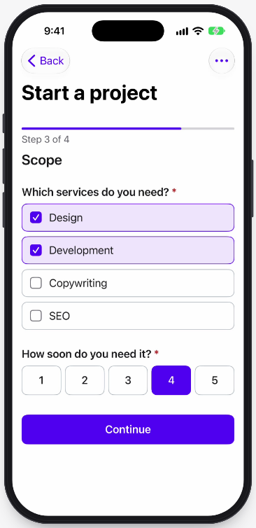
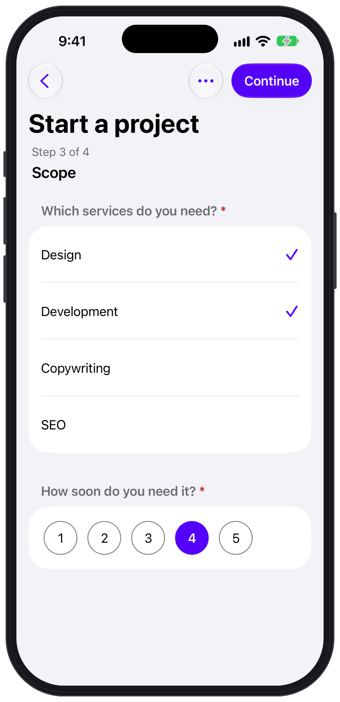
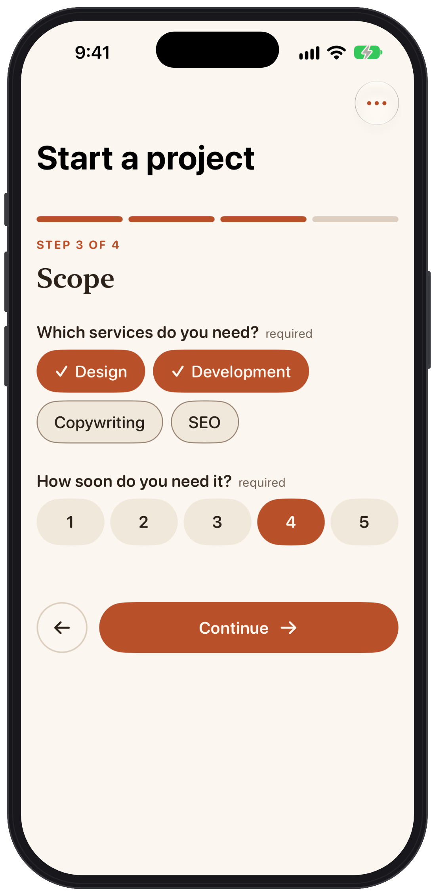

<p align="center">
  
</p>

<p align="center">
  <a href="https://github.com/formhaus-dev/formhaus-swift/actions/workflows/ci.yml"></a>
  
  
  <a href="LICENSE"></a>
</p>

<p align="center">
  Native Swift engine and SwiftUI renderer for <a href="https://github.com/formhaus-dev/formhaus">formhaus</a> JSON form definitions.
</p>

<p align="center">
  <a href="https://formhaus.dev/guide/ios">Documentation</a> ·
  <a href="https://formhaus.dev/playground">Playground</a>
</p>

## Install

Add the package with Swift Package Manager:

```swift
dependencies: [
    .package(url: "https://github.com/formhaus-dev/formhaus-swift.git", from: "0.5.0"),
],
targets: [
    .target(name: "App", dependencies: [
        .product(name: "FormhausCore", package: "formhaus-swift"),
        .product(name: "FormhausUI", package: "formhaus-swift"),
    ]),
]
```

| Product | Contents |
|---|---|
| `FormhausCore` | Engine, validation, `validateSubmission` |
| `FormhausUI` | SwiftUI renderer |
| `FormhausResearch` | Option order for `randomize` fields |

Requires Swift 6.2, iOS 17 or macOS 14. `FormhausCore` uses Foundation and `os`, so it builds for Apple platforms only. There is no JavaScript runtime.

## Quick start

Load a definition and render it. The submit handler returns `.ok`, or `.rejected` with errors that the form shows on the fields:

```swift
import FormhausCore
import FormhausUI
import SwiftUI

let url = Bundle.main.url(forResource: "signup", withExtension: "json")!
let endpoint = URL(string: "https://example.com/signup")!
let definition = try FormDefinition(json: JSONValue(parsing: Data(contentsOf: url)))

struct SignupView: View {
    let definition: FormDefinition

    var body: some View {
        FormhausForm(definition: definition) { values, _ in
            var request = URLRequest(url: endpoint)
            request.httpMethod = "POST"
            request.setValue("application/json", forHTTPHeaderField: "Content-Type")
            request.httpBody = values.jsonData()
            let (data, _) = try await URLSession.shared.data(for: request)
            return try SubmitResult(json: JSONValue(parsing: data))
        }
    }
}
```

`.rejected(errors:formErrors:)` also takes errors that belong to no field. `SubmitResult(json:)` reads the `{ ok, errors, formErrors }` object that a formhaus endpoint returns. `jsonData()` and `jsonString()` on `JSONValue` and `JSONObject` write compact JSON in JavaScript key order. `JSONValue` is also `Codable`, but Foundation's keyed decoding may not keep the key order of the source JSON; use `JSONValue(parsing:)` when order matters. `FormEngine` runs the same form without a UI, for a renderer of your own. The [documentation](https://formhaus.dev/guide/) covers the definition format.

## Randomize options

A `radio`, `multiselect` or `select` field with `"randomize": true` shows its options in a random order per respondent. Add the `FormhausResearch` product and pass `Research()`:

```swift
.product(name: "FormhausResearch", package: "formhaus-swift"),
```

```swift
import FormhausResearch

FormhausForm(definition: definition, options: FormEngineOptions(research: Research())) { values, _ in
    try await send(values)
}
```

Without it, options show in written order. The same `seed` in `FormEngineOptions` shows the same order again.

## Choose a look

The same form in the three sets:

| formhaus | `.system` | Your own |
|:---:|:---:|:---:|
|  |  |  |

### The formhaus set

The default. It matches the web renderers of `@formhaus/react` and `@formhaus/vue`, and uses the formhaus design tokens.

### Native iOS

`.system` renders a grouped `Form`, like a Settings screen. Put it in a `NavigationStack`:

```swift
NavigationStack {
    FormhausForm(definition: definition) { values, _ in .ok }
        .formhausComponents(.system)
}
```

On iOS steps swap in place and never push screens onto your navigation stack. The primary action sits in the toolbar, and from the second step a Back item replaces the back button.

Controls use the tint of your app, also in your own field views: Continue and Back, checkmarks, scale dots, stars, picture selection and the date row. For the Formhaus primary, apply `.tint(...)` around the form. The set shows the definition title as the navigation title and leaves the display mode to your screen. Set `titleDisplayMode` to `.inline` or `.large` to choose it, or to `.off` to set no title:

```swift
.formhausBehavior(FormBehavior(titleDisplayMode: .inline))
```

### Your own components

Register a view per field type on top of a built-in set. Types you leave out keep the built-in views:

```swift
extension FormComponents {
    static let kiln = FormComponents.standard
        .field("text") { KilnTextField(context: $0) }
        .field("email") { KilnTextField(context: $0) }
}

struct KilnTextField: View {
    @Environment(\.formhausTokens) private var tokens
    @FocusState private var focused: Bool
    let context: FieldContext

    var body: some View {
        VStack(alignment: .leading, spacing: 8) {
            Text(verbatim: context.label).formhausText(.label)
            TextField(context.accessibilityName, text: context.textBinding)
                .formhausFocus(context, $focused)
                .overlay(alignment: .bottom) {
                    Capsule().fill(focused ? tokens.colors.primary : tokens.colors.border).frame(height: 1.5)
                }
            if let error = context.error {
                Text(verbatim: error).formhausText(.error)
            }
        }
        .formhausScrollAnchor(context)
    }
}
```

Apply it with `.formhausComponents(.kiln)`. `.formhausFocus` joins focus to the first error, and `.formhausScrollAnchor` lets the form scroll to the field. `.section`, `.group`, `.groupItem`, `.confirmDialog`, `.progress` and `.actions` replace the containers. The full Kiln set is in [`Examples/FormhausDemo/FormhausDemo/Brand`](Examples/FormhausDemo/FormhausDemo/Brand).

Switching the components or the theme of a running form keeps its values, step and errors.

`context.minLength` and `context.maxLength` hold the length limits of `text`, `email`, `phone`, `password` and `textarea` fields, for a character counter.

`revealTargets(nodes)` returns, for each node of a list, the choice field and option that reveal it, following the Revealed fields rule of the [specification](https://github.com/formhaus-dev/formhaus/blob/main/docs/spec.md#revealed-fields). Use it to draw a field under the option that shows it in a layout of your own.

## Show a field under its option

Turn on `conditionalReveal` to draw a field shown by a `radio` or `multiselect` answer under that option, indented with a line on its left:

```swift
.formhausBehavior(FormBehavior(conditionalReveal: true))
```

A field goes under an option when its only condition is `eq` on the `radio` right before it, or `contains` on the `multiselect` right before it. A revealed `radio` can reveal fields of its own. Values, validation and the submit payload do not change. VoiceOver reads the revealed block as a group named after its option, right after that option. The error of a choice field with revealed fields shows above its options.

The `.system` set draws the block under inline choice lists. Fields of menu and pushed pickers, of choices with `layout: "inline"`, picture options or `optionsFrom`, of matrix sections and of group items stay in place, and so do fields of a type you replace with `.field(_:_:)`. See [Show a field under its option](https://formhaus.dev/guide/conditions#show-a-field-under-its-option).

## Validate on the server

`validateSubmission` checks the values against the same definition, with the visibility, steps and routes of the client:

```swift
import FormhausCore

let definition = try FormDefinition(json: JSONValue(parsing: definitionData))

let result = try validateSubmission(definition, try JSONValue(parsing: requestBody))
if result.errors.isEmpty {
    save(result.values)
} else {
    reject(result.errors)
}
```

The body is the values object. `result.values` holds the values of the active path, and `result.errors` maps keys to messages. Pass skipped steps and custom validators in `SubmissionOptions`. `checkDefinition(json)` lists the issues of a definition before you use it.

`validateSubmission` runs every pattern on values of up to 10,000 characters, at most 10,000 pattern tests per call. `checkDefinition` reports patterns that can take very long on some values as `slow-pattern` warnings.

## Validate in code

`onValidate` runs after the definition rules pass, on Continue for the step and on Submit for the whole form:

```swift
let options = FormEngineOptions(onValidate: { values, context in
    guard context.fields.contains("email") else { return nil }
    return try await api.isTaken(values["email"]) ? ["email": "This email is taken"] : nil
})
```

`context.fields` lists the visible field paths in scope, and `context.submit` tells Submit from Continue. Keys outside `fields` show as form errors, and on Submit the form opens the step of the first field error. `errorSummary(engine, options: ErrorSummaryOptions(labels:))` returns the field errors grouped by step for a summary of your own.

With `validateWithRules: true`, `onValidate` also runs when the definition rules fail, so both errors show at once. On Continue it then skips `onStepValidate` and `onBeforeStepChange`. The definition error wins on the same field. Defaults to `false`.

## Keep hidden values

By default a field hidden by a condition loses its value. An editor of a stored record can keep it:

```swift
FormhausForm(definition: definition, initialValues: record, options: FormEngineOptions(hiddenValues: .keep)) { values, _ in
    try await save(values)
}
```

Hidden fields keep their values in `engine.values` and in the submitted values, together with answers on steps off the active path. Conditions, validation and recall still treat them as unanswered, so they never block Continue or Submit. Pass `SubmissionOptions(hiddenValues: .keep)` to `validateSubmission`, or the server drops them.

## Restore after the app is closed

The system can end the app while it is in the background. Save the form's snapshot and pass it back to `restoring:` to bring back the answers, the current step and the skipped steps. Keep the draft in a store that outlives the form view, so the `nil` sent after a submit is saved too:

```swift
@MainActor
final class SignupDraft {
    private let key = "signup.draft"
    private(set) var snapshot: FormSnapshot?

    init() {
        snapshot = UserDefaults.standard.data(forKey: key).flatMap { FormSnapshot.decode($0) }
    }

    func save(_ next: FormSnapshot?) {
        snapshot = next
        UserDefaults.standard.set(try? next.map { try JSONEncoder().encode($0) }, forKey: key)
    }
}

@main
struct SignupApp: App {
    @State private var draft = SignupDraft()

    var body: some Scene {
        WindowGroup { SignupView(draft: draft) }
    }
}

struct SignupView: View {
    let draft: SignupDraft

    var body: some View {
        FormhausForm(
            definition: signup,
            renderer: FormRendererOptions(onSnapshotChange: draft.save),
            restoring: draft.snapshot
        ) { values, _ in
            try await send(values)
        }
    }
}
```

`onSnapshotChange` gets a new snapshot at most once per run loop turn, and `nil` after a successful submit so the draft goes away. A snapshot saved for another form, or for a step the definition no longer has, starts the form fresh and reports `snapshot-mismatch` through `onWarning`. Password values are never in a snapshot. A picked file comes back while its copy still exists.

Snapshot values can hold personal data. User defaults are not encrypted, so for such forms store the snapshot in the Keychain or in a file with data protection, and delete it when the user signs out.

## Translations

Formhaus ships message and label catalogs for `en`, `es`, `fr`, `fr-CA`, `de`, `pt-BR`, `it`, `ja`, `zh-CN`, `ru` and `uk`:

```swift
let locale = localeChain(Locale.current.identifier(.bcp47)).compactMap(LocaleCatalog.bundled)
FormhausForm(definition: definition, options: FormEngineOptions(locale: locale)) { values, _ in
    try await send(values)
}
```

Per key, `messages` wins over the definition's `messages`, which wins over the catalogs in list order, which win over the built-in English. `localeChain` adds the likely region, so `zh-Hans-CN` also finds `zh-CN`. A text can be `PluralForms`, picked by `{count}`, `{min}` or `{max}` with the CLDR rules of the catalog locale, and that number is formatted for the same locale. `checkCatalog(_:)` lists the missing and unknown keys of a catalog JSON. Set `engine.locale` to switch the language of an open form. `FormhausForm` does this when the `locale` in its options changes.

`missingKeys(messages:labels:)` lists the built-in message and label keys that a catalog lacks, for a unit test of your translations. In debug builds, a form with a `messages` or `labels` catalog reports `missing-message-key` or `missing-label-key` through `onWarning` when it shows a text that neither the catalog nor the definition's own `messages` or `labels` supply. Each key is reported once per process.

## Theming

`FormhausTheme` holds the [formhaus design tokens](https://github.com/formhaus-dev/formhaus/tree/main/packages/core/tokens): light and dark palettes, type sizes, spacing, radii, control sizes and motion. `.standard` picks `.touch` on iOS and `.pointer` on macOS.

```swift
extension FormhausTheme {
    static let brand: FormhausTheme = {
        var theme = FormhausTheme.standard
        theme.light.primary = Color(red: 0.72, green: 0.31, blue: 0.16)
        theme.dark.primary = Color(red: 0.91, green: 0.51, blue: 0.35)
        theme.radii.control = 22
        return theme
    }()
}

FormhausForm(definition: definition) { values, _ in .ok }
    .formhausTheme(.brand)
```

Custom views read the resolved tokens from `@Environment(\.formhausTokens)` and style text with `.formhausText(_:)`. Under Increase Contrast the built-in palettes switch to the `contrast: more` values of the tokens, and custom palettes get raised borders and text. Set `lightIncreased` and `darkIncreased` to choose those colours yourself.

## Accessibility

- Every control has a VoiceOver label from the field label, with "required" for required fields.
- After a failed Continue or Submit, VoiceOver focus moves to the error summary when it lists two or more errors, and to the invalid field otherwise. On a step change it moves to the step title.
- Text sizes follow Dynamic Type, and motion stops with Reduce Motion.
- Tap targets are at least 44 pt.
- At standard contrast the input border is about 2:1 against the background, below the 3:1 of WCAG 1.4.11. This is deliberate and matches the web renderers.
- Increase Contrast switches to the `contrast: more` palette. Input, card and secondary borders then reach about 3.7:1, and muted text, placeholders, errors and the primary colour are raised to the native targets.

## UI tests

Set `testIds` to give the form accessibility identifiers for XCUITest. They are off by default:

```swift
FormhausForm(definition: definition, renderer: FormRendererOptions(testIds: .automatic)) { values, _ in .ok }
```

`.automatic` names each element after the definition `id` with the scheme of the web `testIds`: `<id>.form`, `<id>.<key>`, `<id>.<key>.<value>`, `<id>.<group>.<index>.<key>`, `<id>.submit`, `<id>.next`, `<id>.back` and `<id>.summary`. `<id>.cancel` exists only in Swift. The identifiers land here:

| Id | Formhaus set | `.system` |
|---|---|---|
| `signup.form` | The scroll view of `FormhausForm`. `FormhausFormContent` on its own has none. | The `Form` list |
| `signup.email` | The field row, a container that holds the label, the control and the error | The field row container. For a textarea, scale, rating or picture field, the container of its block. For an inline choice list, the section header text. |
| `signup.plan.pro` | Each option of a radio, multiselect or matrix row, each scale point and each star. A `select` has none. | Each row of an inline choice list or of the pushed option list, and each picture tile. Scale, rating and menu pickers have none. |
| `signup.people.0.name` | A field in a group item, placed like other fields | The same |
| `signup.submit`, `signup.next` | The primary button | The primary button in the toolbar |
| `signup.back`, `signup.cancel` | The Back and Cancel buttons, also Back in the navigation bar | The Back and Cancel buttons in the toolbar and below the form |
| `signup.summary` | The error summary container | The header text of the error summary section |

A field id sits on the row, not on the input. Query the input inside it:

```swift
app.descendants(matching: .any)["signup.email"].textFields.firstMatch.typeText("ada@example.com")
app.buttons["signup.next"].tap()
```

With ids on, the `.system` set wraps each field row in an accessibility container that holds the id. VoiceOver does not read identifiers. `.custom { target in ... }` names the ids yourself from a `TestIdTarget`. Custom field views read `context.testId` and `context.optionTestId(_:)`, and custom actions read `context.testIds`.

## Compatibility

| formhaus-swift | @formhaus/core | Format |
|---|---|---|
| 0.6.1 | 1.8.0 | 1.7 |
| 0.6.0 | 1.8.0 | 1.7 |
| 0.5.0 | 1.6.1 | 1.6 |
| 0.4.0 | 1.6.0 | 1.6 |
| 0.3.0 | 1.4.2 | 1.6 |
| 0.2.0 | 1.3.0 | 1.6 |
| 0.1.7 | 1.3.0 | 1.6 |
| 0.1.6 | 1.2.2 | 1.6 |
| 0.1.5 | 1.2.0 | 1.6 |
| 0.1.4 | 1.1.1 | 1.6 |
| 0.1.3 | 1.0.0 | 1.5 |
| 0.1.0 to 0.1.2 | 0.22.0 | 1.5 |

Each release pins a tag of [@formhaus/core](https://github.com/formhaus-dev/formhaus) and runs its [conformance suite](https://github.com/formhaus-dev/formhaus/tree/main/packages/core/fixtures/conformance): 87 definition files with their issues, value cases, recall cases, option order vectors and revealed fields, and 477 engine scenarios. Every scenario runs through `FormEngine` as its own test.

## Performance

Patterns run on a native ECMAScript 2025 regex engine, so a pattern matches the same values as in the browser. Patterns without backreferences match in time linear in the input, and every match has a step budget, so no pattern can hang the app.

- An email pattern check takes 0.79 µs.
- A form with 3,000 picture options renders in 152 ms, and a selection takes 3.5 ms.

Measured on an Apple M5 Pro with macOS 26.6 and Swift 6.4, in a release build.

In the demo app, a 4-step form with picture options, conditions, a rating and a server error:

| Metric | Value |
| --- | --- |
| FormhausCore in the app binary | 1.1 MiB |
| FormhausUI in the app binary | 1.6 MiB |
| Peak memory of the whole app | 66 MB |

Sizes come from the linker map of a stripped Release arm64 iOS build. Memory is `phys_footprint_peak` on an iPhone 17 Pro simulator with iOS 27 after the full fill and submit.

## Differences from TypeScript

- Answer recall formats with Foundation format styles in UTC. A `RecallFormatFn` receives a `RecallAnswer`, the field and the locale.
- A pattern match stops after 10,000,000 steps, and one validation call has 20,000,000 steps for all its patterns. A pattern that runs out fails its rule. Values are at most 10,000 code units long, and a pattern with more than 100 nested groups is invalid.
- The JSON parser rejects unpaired surrogate escapes and documents nested deeper than 512 levels.
- Hooks are always `async`. Without `onWarning`, definition warnings go to `os.Logger` with subsystem `dev.formhaus`.
- A `file` field writes the URL of a copy in the temporary directory. Read it with `FormModel.pickedFile(forKey:)`, or with `FormModel.pickedFiles(forKey:)` for a field with `multiple`.
- Hidden field `source` values are not resolved. Pass them in the initial values.
- There are no drafts and no Cloud client.
- Plural rules cover the languages of the shipped catalogs, and other languages use the `other` form.

## Demo app

`Examples/FormhausDemo` is a SwiftUI app for iPhone, iPad and Mac. It renders a three-step project inquiry with a route, conditional fields, picture options, a rating, a matrix, a scale, recall and a server error. The options menu switches between the formhaus, native and Kiln sets on the same form, and to German.

Open `Examples/FormhausDemo/FormhausDemo.xcodeproj` and run the `FormhausDemo` scheme, or build it from the command line:

```sh
xcodebuild build -project Examples/FormhausDemo/FormhausDemo.xcodeproj -scheme FormhausDemo -destination 'generic/platform=macOS'
```

The fake server takes about a second and rejects `ada@lovelace.dev` as already registered. The same definition runs in the [playground](https://formhaus.dev/playground).

## Contributing

See [CONTRIBUTING.md](CONTRIBUTING.md). Behaviour changes start in the [formhaus](https://github.com/formhaus-dev/formhaus) repository.

## Security

Report vulnerabilities privately. See [SECURITY.md](SECURITY.md).

## License

[MIT](LICENSE)
